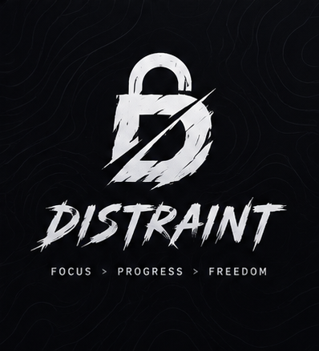
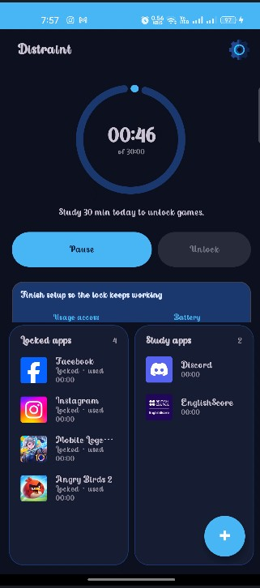
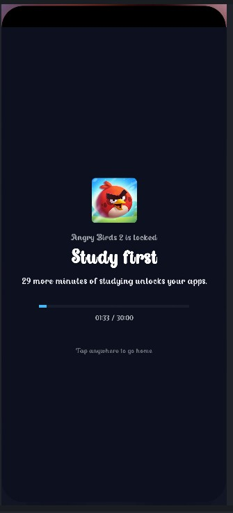

# Distraint
<p align="center">
  
</p>

<h3 align="center">Focus &gt; Progress &gt; Freedom</h3>

<p align="center">
  Earn your screen time by studying.
</p>

Distraint is an Android app that locks the apps that pull you away from your work, like games and social media. The only way to unlock them is to put in real time studying or working, which the app tracks for you.

No willpower required: if you want to scroll, you have to earn it first.

---

## How it works

1. **Pick your distractions.** Choose the apps you want locked, such as games, social media, and video apps.
2. **Study or work.** Start a focus session in Distraint. The app tracks the time you put in.
3. **Earn unlock time.** The time you spend focusing becomes time you can spend in your locked apps.
4. **Get a heads-up.** When your unlock time is about to run out, Distraint shows a countdown in your notifications so the lock never catches you by surprise.
5. **Back to work.** When the time is up, the apps lock again until you earn more.

## Features

- Locks any apps you choose
- Study and work time tracking
- Unlock time that you earn by focusing
- Countdown notification before your unlock time runs out
- Guided onboarding that explains each permission before asking for it

<!-- Add or remove items above to match what your app actually does. -->

## Screenshots

## Screenshots

<p float="left">
  
  
</p>


## Installation

### Download the APK

1. Go to the [Releases](https://github.com/ViCiAsh/Distraint-/releases) page.
2. Download the latest apk.
3. Open it on your phone. If asked, allow **Install unknown apps** for your browser or file manager.
4. Follow the onboarding screens to grant the permissions the app needs.

### Build from source

Requirements: [Android Studio](https://developer.android.com/studio) and JDK 17 or newer.

```bash
git clone https://github.com/ViCiAsh/Distraint-.git
cd Distraint-
```

Open the folder in Android Studio, let Gradle sync, and press **Run**. Or build a debug APK from the terminal:

```bash
# Windows
gradlew assembleDebug

# macOS / Linux
./gradlew assembleDebug
```

The APK is created at `app/build/outputs/apk/debug/app-debug.apk`.

## Permissions

Distraint needs a few permissions to work. Nothing is requested without an explanation first.

| Permission | Why it's needed |
| --- | --- |
| Notifications (Android 13+) | Shows the countdown when your unlock time is about to run out |
| Device admin | Helps keep the lock in place so it can't be bypassed easily |

<!-- Check this table against your AndroidManifest.xml and add any other permissions the app uses,
such as usage access, display over other apps, or accessibility. -->

## Privacy

Distraint is built to run on your device. <!-- Edit this if the app sends any data anywhere. -->
It does not require an account.

## Tech stack

- Java
- Android SDK
- Material Components
- Gradle (Kotlin DSL)

## Contributing

Bug reports and ideas are welcome. Open an [issue](https://github.com/ViCiAsh/Distraint-/issues), or fork the repo and send a pull request.

## License

This project is licensed under the terms of the [LICENSE](LICENSE) file.
